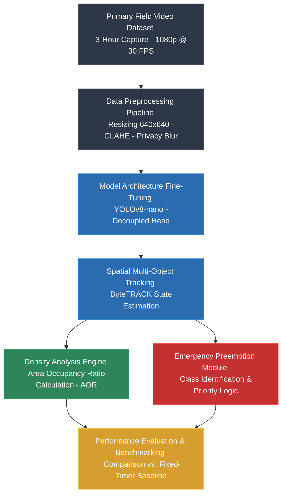

# Real-Time Traffic Volume Estimation and Emergency Vehicle Priority at Unlaned Intersections in Sri Lanka

[](https://www.python.org/downloads/)
[](https://github.com/ultralytics/ultralytics)
[](https://pytorch.org/)

An edge-based Intelligent Transportation System (ITS) designed to perform localized vehicle detection, density estimation, and emergency vehicle preemption across heterogeneous, unlaned traffic environments in Sri Lanka without relying on active cloud connections.

---

## Project Overview

Urban intersections in developing nations like Sri Lanka operate under severe vehicle heterogeneity (e.g., three-wheelers, motorcycles, buses) and a total absence of lane discipline. Traditional fixed-timer signals and lane-centric Adaptive Traffic Control Systems (ATCS) fail under these conditions, leading to severe delays and blocked emergency medical routes.

This project fine-tunes a single-stage **YOLOv8-nano** model deployed on edge hardware (Raspberry Pi 4B) to:
1. **Detect & Track** heterogeneous vehicles under high inter-vehicle occlusion using **ByteTRACK**.
2. **Compute Real-Time Congestion** using a dynamic **Area Occupancy Ratio (AOR)** within a defined Region of Interest ($ROI$) instead of simple vehicle counts.
3. **Trigger Emergency Preemption** when priority vehicles (`Emergency_Vehicle`) enter the field of view, dynamically clearing traffic paths.

---

## Repository Structure

```text
SriLankan-Unlaned-Traffic-YOLOv8/
├── .gitignore                 # Excludes raw datasets, video streams, and virtual environments
├── README.md                  # Comprehensive project documentation
├── requirements.txt           # Python dependency specifications
├── data/
│   ├── raw/                   # Raw video frame sampling placeholders (.gitkeep)
│   └── processed/             # Anonymized and normalized dataset split structure
├── scripts/
│   ├── anonymize_privacy.py   # Facial & license plate blur preprocessor (Gaussian)
│   ├── calculate_iaa.py       # Inter-annotator agreement validator (IoU & Cohen's Kappa)
│   └── dataset_prep.py        # Frame extraction, resizing (640x640), and split manager
└── src/
    ├── models/                # YOLOv8 fine-tuning configurations & anchor-free head setups
    └── tracking/              # ByteTRACK multi-object integration & Area Occupancy Engine
```
---

## Dataset & Curation Protocol

* **Primary Collection Protocol**: 3-hour stratified field video capture ($1080\text{p at } 30\text{ FPS}$) from elevated vantage points ($35^\circ$ downward pitch) across major unlaned Colombo junctions (Rajagiriya, Borella, Battaramulla).
* **Sample Size**: 4,000 curated, anonymized images extracted at $1\text{ FPS}$ with over 48,000+ individual labeled vehicle instances.
* **Target Classes**: Three-Wheeler (35%), Motorcycle (30%), Car_Van (20%), Bus_Truck (10%), and Emergency_Vehicle (5%).
* **Ethical Compliance**: Automated Gaussian blurring ($21 \times 21$ kernel) applied across detected pedestrian faces and vehicle license plates prior to annotation.

---

## Quick Start & Setup
### Prerequisites
Ensure Python 3.10+ and Git are installed on your local environment or edge device.

### Clone the Repository
```bash
git clone [https://github.com/NethraDiwaman/SriLankan-Unlaned-Traffic-YOLOv8.git](https://github.com/NethraDiwaman/SriLankan-Unlaned-Traffic-YOLOv8.git)
cd SriLankan-Unlaned-Traffic-YOLOv8
```
### Create a Virtual Environment
```bash
# Windows (PowerShell)
python -m venv venv
.\venv\Scripts\Activate.ps1

# Linux / macOS
python3 -m venv venv
source venv/bin/activate
```
### Install Dependencies
```bash
pip install --upgrade pip
pip install -r requirements.txt
```

---

## Running Preprocessing Scripts
### Run Privacy Anonymization
To execute privacy scrubbing on extracted frame folders:
```bash
python scripts/anonymize_privacy.py
```
### Compute Inter-Annotator Agreement (IAA)
To validate bounding-box overlap consistency between labeling passes:
```bash
python scripts/calculate_iaa.py
```

---

## Experimental Framework & Methodology Pipeline



---

## Authors & Academic Context
* W.G.N. Nethra Diwaman (Student ID: ITBIN-2312-0013)
* Rasanga V. Bandara (Student ID: ITBIN-2312-0002)

* Module: IT41043 — Intelligent Systems
* Faculty: Faculty of Information Technology, Horizon Campus, Sri Lanka.
